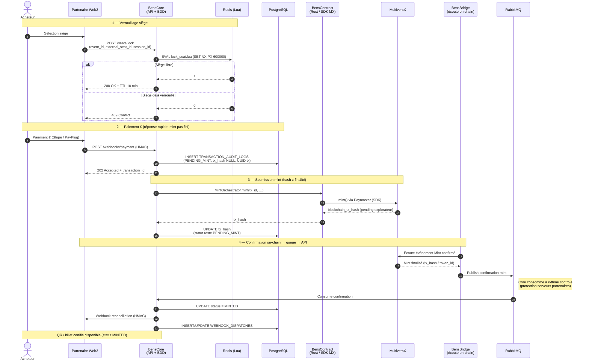

# Cahier des Charges Fonctionnel et Technique — Projet BENS

> **Référence US 1.1** — Documenter l'Expression du Besoin et l'Architecture distribuée  
> **Architecture détaillée** : [`docs/03-conception/architecture.md`](../03-conception/architecture.md) (US 1.7)  
> **Principe transverse** : BENS est un *middleware* transmetteur de messages et forgeur de NFT/SBT — **jamais une billetterie bis**. La donnée métier billetterie (catalogue, sièges, prix, panier, checkout) reste chez le partenaire Web2.

---

## 0. Expression du besoin

### 0.1. Contexte

Les billetteries B2B partenaires (Ticketmaster, Digitick, Fnac Spectacles, etc.) gèrent déjà le catalogue d'événements, le plan de salle, le panier et le paiement en euros. Elles ont besoin d'une couche d'interopérabilité pour :

1. **Capter la valeur du marché secondaire** : ancrer des royalties de revente dans un smart contract MultiversX afin que l'organisateur capte automatiquement une part de chaque revente, à perpétuité — valeur structurellement inaccessible en Web2 (part aujourd'hui aux scalpers et plateformes de revente).
2. **Gouverner le marché secondaire** : plafond de prix, SBT non transférable optionnel, limite par utilisateur, anti-bot — l'organisateur reprend le contrôle.
3. **Certifier le billet** sur blockchain (MultiversX) de façon transparente pour l'acheteur final.
4. **Absorber les pics de charge** (drops) sans saturer leur BDD SQL — enableur technique, non l'argument produit principal.

### 0.2. Objectif produit

BENS (Blockchain Event Network System) est un **middleware API-First, stateless, event-driven** qui :

- ancre les règles de revente (plafond, royalties, SBT) dans un smart contract MultiversX déployé via Bens Contracts, et paie les gas fees via Paymaster (Account Abstraction) ;
- verrouille des sièges **en mémoire** (Redis + Lua) à partir d'identifiants opaques fournis par le partenaire ;
- reçoit la confirmation de paiement € via webhook, l'audite, et ordonne le mint asynchrone ;
- forge un NFT/SBT sur MultiversX via Bens Contracts (Paymaster) ;
- réconcilie le partenaire via webhook sortant signé HMAC ;
- expose un dashboard organisateur pour configurer un *bridge* d'événement et déployer le smart contract.

### 0.3. Hors scope (discipline middleware)

BENS **ne doit pas** :

| Interdit | Raison |
| :--- | :--- |
| Stocker le catalogue d'événements / catégories / descriptions | Donnée partenaire Web2 |
| Stocker plans de sièges, labels (`section`, `row`, `seat_number`) | Seul `external_seat_id` opaque est transporté |
| Gérer panier, checkout, paiement € | Responsabilité partenaire (Stripe/PayPlug) |
| Calculer un total ou un prix facial | Seul `payment_provider_ref` est audité |
| Exposer un `GET /events` catalogue | Dérive billetterie bis |
| Demander au partenaire de connaître MultiversX | DX : intégration en quelques heures |

**Règle de décision (3 questions)** avant toute nouvelle table / endpoint / entité :

1. Cette donnée existe-t-elle déjà chez le partenaire Web2 ? → Si oui, BENS ne la stocke pas (identifiant opaque uniquement).
2. Sert-elle à transmettre un message ou à forger un NFT ? → Sinon, hors scope.
3. Sans elle, BENS peut-il encore certifier le billet ? → Si oui, c'est du métier billetterie → laisser au partenaire.

---

## 1. Architecture distribuée — 3 microservices

### 1.1. Vue d'ensemble

```text
┌──────────────────────┐   mint / deploy    ┌──────────────────────┐
│      BensCore        │ ─────────────────► │    BensContract      │
│  API + Redis + Audit │                    │  Rust + SDK MX      │
│  + MintOrchestrator  │                    │  SC + Paymaster      │
│  + Consume RabbitMQ  │                    └──────────▲───────────┘
│  + Webhooks sortants │                               │ écriture
│  + Dashboard Angular │                               │ on-chain
└──────────▲───────────┘                               │
           │ lock / unlock / payment WH / QR           │ events
           │ + webhooks sortants HMAC                  │
    ┌──────┴──────┐                         ┌──────────┴───────────┐
    │ Partenaire  │                         │     BensBridge       │
    │ Web2        │                         │  écoute on-chain     │
    └─────────────┘                         │  publish RabbitMQ    │
                                            │  (pas de BDD)        │
                                            └──────────┬───────────┘
                                                       │ confirmations
                                                       ▼
                                                  RabbitMQ → BensCore
```

| Microservice | Responsabilité | Persistance |
| :--- | :--- | :--- |
| **BensCore** | API partenaire, verrou Redis Lua, **réception webhook paiement**, **seule** écriture PostgreSQL (`PENDING_MINT` → hash → `MINTED`), orchestration mint, **consommation RabbitMQ** (rythme contrôlé), **webhooks sortants HMAC**, dashboard, QR statique (POC) | PostgreSQL + Redis + RabbitMQ (consume) |
| **BensContract** | Microservice Rust : SDK MultiversX, déploiement SC, mint on-chain, Paymaster, Smart Wallet, Web3 Gateway ; **retourne** adresse SC / `tx_hash` à Core | MultiversX uniquement (**pas** de PostgreSQL) |
| **BensBridge** | Écouteur blockchain (Mint / Transfer / Resale), publication des confirmations dans RabbitMQ | RabbitMQ (publish) — **pas** de PostgreSQL, **pas** de webhook partenaire |

> **Décisions actées** : BensCore seul sur la BDD et les webhooks sortants ; BensCore appelle BensContract pour minter (**pas de RabbitMQ pour soumettre le mint**) ; `tx_hash` stocké en restant `PENDING_MINT` ; Bridge publie la confirmation on-chain ; Core consomme → `MINTED` + notifie le partenaire.

### 1.2. Stack technique complète

| Couche | Technologie | Version / contrainte |
| :--- | :--- | :--- |
| Langage backend | **Java** | **25** (LTS) — Virtual Threads (Project Loom) |
| Framework backend | **Spring Boot** | **4+** |
| Frontend dashboard | **Angular** | **18+** |
| Blockchain | **MultiversX** / **Rust** | Smart Contracts + Account Abstraction (Paymaster) |
| Cache / verrous | **Redis** | Cluster + scripts Lua atomiques |
| Broker de messages | **RabbitMQ** | Exchange topic + DLQ |
| Base relationnelle | **PostgreSQL** | Audit, config bridges, webhooks (UUID PK) |
| Style | Middleware API-First, **stateless**, Event-Driven (EDA) | — |

> Cette stack est **normative** pour le dépôt. Toute divergence doit être justifiée et mise à jour ici.

### 1.3. Surface d'API partenaire (DX)

Surface volontairement contractée — **pas plus** :

| Endpoint | Rôle | Composant |
| :--- | :--- | :--- |
| `POST /seats/lock` | Verrouiller un siège (`event_id`, `external_seat_id`, `session_id`) → `200` + TTL ou `409` | BensCore |
| `POST /seats/unlock` | Libérer un siège (compare-and-delete) | BensCore |
| `POST /webhooks/payment` | Webhook paiement confirmé (signé HMAC) → `202 Accepted` | **BensCore** |
| `GET /transactions/{id}` | Statut d'une transaction d'audit | BensCore |
| Dashboard organisateur | Configurer bridge + déployer SC + suivre royalties | BensCore (Angular) |

Codes d'erreur explicites : `SEAT_ALREADY_LOCKED`, `SEAT_SOLD`, `MAX_TICKETS_REACHED`, `INVALID_SIGNATURE`, etc.

Identifiants :

- `org_id`, `event_id` : **UUID BENS** (jamais un slug partenaire dans Redis).
- `external_event_id`, `external_seat_id` : **VARCHAR opaques** fournis par le partenaire, non interprétés.

---

## 2. Diagramme de séquence inter-services

### 2.1. Achat + certification (Core → Contracts → Bridge)

> Aligné sur [`architecture.md`](../03-conception/architecture.md) : BensCore
> reçoit le paiement, orchestre le mint, consomme les confirmations et notifie ;
> BensBridge écoute la chaîne et publie dans RabbitMQ.



### 2.2. Mapping des 10 étapes du parcours acheteur

| # | Étape | Composant | Écriture MLD |
| ---: | :--- | :--- | :--- |
| 1 | Sélection du siège | Partenaire Web2 | — |
| 2 | `POST /seats/lock` | BensCore (Redis Lua) | — (in-memory) |
| 3 | Verrou 200 OK + TTL 10 min | BensCore | — |
| 4 | Paiement € | Partenaire Web2 | — |
| 5 | Webhook paiement → BENS | **BensCore** | `TRANSACTION_AUDIT_LOGS` (`PENDING_MINT`, `tx_hash NULL`) |
| 6 | Écriture audit + `202` | **BensCore** | idem |
| 7 | Ordre de mint | **BensCore → BensContract** | — (appel direct, pas RabbitMQ) |
| 8 | Soumission mint + hash | BensContract → MX → Core | Core `UPDATE` `tx_hash` (reste `PENDING_MINT`) |
| 9 | Confirmation on-chain + webhook | Bridge → MQ → **BensCore** | Core `UPDATE MINTED` + `WEBHOOK_DISPATCHES` |
| 10 | Billet + QR **statique** | BensCore | — |

### 2.3. Parcours organisateur (configuration du bridge)

```text
1. Connexion Dashboard BENS (RBAC)
2. Création d'un EVENT_BRIDGES (status = DRAFT)
3. Saisie de external_event_id (opaque)
4. Configuration EVENT_SMART_RULES (1:1 avec EVENT_BRIDGES) :
   • token_type = NFT | SBT
   • max_resale_price_percent (BigDecimal)
   • royalty_fee_percent (BigDecimal)
   • max_tickets_per_user
   • allow_secondary_market
5. « Déployer & Activer »
6. BensCore orchestre → BensContract déploie le SC sur MultiversX
7. BensContract retourne smart_contract_address → BensCore l'écrit dans EVENT_BRIDGES
8. status → ACTIVE ; clés API + URL webhook de callback
   États bridge : DRAFT → ACTIVE → PAUSED → ARCHIVED
```

---

## 3. Spécifications Fonctionnelles (SF)

### 3.1. Module de réservation in-memory (Drop & High-Concurrency)

| ID | Intitulé | Critère mesurable | Composant | Table MLD |
| :--- | :--- | :--- | :--- | :--- |
| **SF-01** | Verrouillage de siège (Redis Lua) | Verrou en mémoire **< 2 ms**, script Lua atomique | BensCore (Redis) | — (in-memory) |
| **SF-02** | Expiration automatique (TTL) | TTL **10 min** exactes, libération sans altération de données | BensCore (Redis) | — (in-memory) |
| **SF-03** | Anti-overbooking | 1er → **200 OK**, 2e → **409 Conflict** | BensCore (API) | — |

#### 3.1.1. Spécification du flux de réservation atomique (Lock Redis)

**Convention de clés** (aucun slug / nom d'événement devinable) :

| Clé Redis | Rôle |
| :--- | :--- |
| `lock:seat:{org_id}:{event_id}:{external_seat_id}` | Verrou d'un siège |
| `lock:session:{org_id}:{session_id}` | Index de cleanup par session |
| `queue:event:{org_id}:{event_id}` | File d'attente drop (optionnel) |

`org_id` et `event_id` sont des **UUID BENS**. `external_seat_id` est transporté tel quel (pas de table pivot).

**Script Lua de verrouillage** (`SET NX PX 600000`) :

```lua
-- KEYS[1] = lock:seat:{org_id}:{event_id}:{external_seat_id}
-- ARGV[1] = session_id
-- ARGV[2] = ttl_ms (600000)
if redis.call('EXISTS', KEYS[1]) == 1 then
  return 0  -- → 409 Conflict
end
redis.call('SET', KEYS[1], ARGV[1], 'PX', ARGV[2])
return 1    -- → 200 OK
```

**Unlock** : compare-and-delete atomique (seul le propriétaire `session_id` peut libérer).

**Isolation BDD (NFR-03)** : **0 écriture** PostgreSQL / BDD partenaire pendant sélection et verrouillage.

### 3.2. Module de certification et Smart Contracts (Web3 masqué)

| ID | Intitulé | Critère mesurable | Composant | Table MLD |
| :--- | :--- | :--- | :--- | :--- |
| **SF-05** | Mint asynchrone | Après paiement € : `202` immédiat ; mint Core→Contract ; `MINTED` + webhook après conf Bridge→MQ→Core | BensCore + BensContract + BensBridge | `TRANSACTION_AUDIT_LOGS` / `WEBHOOK_DISPATCHES` |
| **SF-06** | Masquage blockchain (Paymaster) | Smart Wallet + gas fees payés par BENS | BensContract (Paymaster) | — |
| **SF-07** | QR Code | QR **statique** (scope POC) ; dynamique reporté hors POC | BensCore (QR) | — |

**Topologie RabbitMQ** (confirmations Bridge → Core — **pas de queue pour soumettre le mint**) :

- Exchange : `bens.confirmations` (topic)
- Queue : `bens.mint.confirmations` + DLQ `bens.mint.confirmations.dlq`
- Routing key : `confirm.{org_id}.{event_id}`
- Retry exponentiel : 1s, 5s, 30s, 5min → DLQ après 4 tentatives
- Producteur : **BensBridge** ; consommateur : **BensCore** (rate-limité)
- Webhooks sortants HMAC : **BensCore** (après `MINTED`)

### 3.3. Module Dashboard Organisateur & Marché Secondaire

| ID | Intitulé | Critère mesurable | Composant | Table MLD |
| :--- | :--- | :--- | :--- | :--- |
| **SF-09** | Règles de revente | Plafond prix + royalties configurables ; royalties tracées dans `SECONDARY_SALES` | BensContract (SC) + BensCore (dashboard) | `EVENT_SMART_RULES` / `SECONDARY_SALES` |
| **SF-10** | SBT intransférables (optionnel) | Forçage SBT possible par organisateur | BensContract (SC) | `EVENT_SMART_RULES` |

#### 3.3.1. Règles de calcul des royalties B2B (`BigDecimal`)

Tous les pourcentages monétaires sont des **`DECIMAL(5,2)` / `BigDecimal`** (jamais `float` / `double`) pour éviter les erreurs d'arrondi.

| Colonne MLD (`EVENT_SMART_RULES`) | Type | Domaine | Rôle |
| :--- | :--- | :--- | :--- |
| `max_resale_price_percent` | `DECIMAL(5,2)` | `0.00` → `200.00` | Plafond de revente (% du prix facial) |
| `royalty_fee_percent` | `DECIMAL(5,2)` | `0.00` → `50.00` | Royalties organisateur (% du prix de revente) |
| `token_type` | `VARCHAR` | `NFT` \| `SBT` | Transférable ou Soulbound |
| `allow_secondary_market` | `BOOLEAN` | — | Forcé `false` si `token_type = SBT` |
| `max_tickets_per_user` | `INTEGER` | défaut `4` | Anti-bot |

**Formules (arithmétique exacte `BigDecimal`)** :

```text
plafond_revente  = prix_facial × (max_resale_price_percent / 100)
                   avec scale = 2, RoundingMode.HALF_UP
                   contrainte : prix_revente ≤ plafond_revente

royalty          = prix_revente × (royalty_fee_percent / 100)
                   avec scale = 2, RoundingMode.HALF_UP
                   créditée automatiquement à l'organisateur via le SC
```

**Exemples** :

| Prix facial | Plafond % | Revente max | Royalty % | Royalty sur revente 100 € |
| ---: | ---: | ---: | ---: | ---: |
| 100,00 € | 100,00 | 100,00 € | 10,00 | 10,00 € |
| 80,00 € | 150,00 | 120,00 € | 5,00 | 6,00 € (si revente à 120 €) |

Flux de revente : vérification plafond → transfer on-chain → royalties SC créditées à l'organisateur → BensBridge détecte Resale → INSERT `SECONDARY_SALES` (`royalty_amount`, `resale_price`, `blockchain_tx_hash`) → dashboard agrège les royalties perçues (captation de valeur).

---

## 4. Spécifications Non-Fonctionnelles (NFR)

### 4.1. Performance & Scalabilité

| ID | Intitulé | Critère mesurable | Composant |
| :--- | :--- | :--- | :--- |
| **NFR-01** | Latence clic | Réponse API verrouillage **< 2 ms** à charge nominale | BensCore (Redis) |
| **NFR-02** | Débit | **≥ 10 000 req/s** sur instance standard sans saturation CPU/RAM | BensCore (API) |
| **NFR-03** | Isolation BDD | **0 écriture** BDD SQL partenaire pendant sélection/verrouillage | BensCore (Redis) |

### 4.2. Résilience, idempotence & disponibilité

| ID | Intitulé | Critère mesurable | Composant |
| :--- | :--- | :--- | :--- |
| **NFR-04** | Tolérance aux pannes | Replay possible via `transaction_audit_logs` + retries webhooks / DLQ | BensCore (replay) |
| **NFR-05** | Idempotence | Webhooks + ordres de mint idempotents (**UUID transaction unique**) | BensCore |
| **NFR-06** | Disponibilité Web3 | Indisponibilité Web3 **ne bloque jamais** l'achat € (`202` immédiat, mint / finalité après) | BensCore (orchestration) |

**Idempotence** :

- UUID de transaction généré par **BensCore** à la réception du webhook paiement, propagé jusqu'au mint et au webhook sortant.
- `TRANSACTION_AUDIT_LOGS.payment_provider_ref` est **UNIQUE**.
- Avant mint : si `blockchain_tx_hash` déjà présent → pas de re-mint ; Core peut rejouer le webhook sortant uniquement.
- `SECONDARY_SALES.blockchain_tx_hash` est **UNIQUE** (une revente on-chain = une ligne).

---

## 5. Persistance middleware (aperçu MLD)

Tables **propres au middleware** uniquement (détail : `docs/03-conception/mcd/mld.md`) :

| Table MLD | Entité MCD | Rôle |
| :--- | :--- | :--- |
| `MERCHANTS` | Merchant | Partenaires B2B |
| `COLLABORATORS` | Collaborator | Accès dashboard (RBAC) |
| `BLACKLISTED_IPS` | BlacklistedIp | Ban IP multi-tenant |
| `EVENT_BRIDGES` | EventBridge | Bridge événement + adresse SC (écrite par BensCore après retour Contract) |
| `EVENT_SMART_RULES` | EventSmartRules | Règles SC (1:1) — royalties, plafond, SBT |
| `TRANSACTION_AUDIT_LOGS` | TransactionAuditLog | Audit paiement → mint (écrit par **BensCore**) |
| `SECONDARY_SALES` | SecondarySale | **Preuve de captation de valeur** (écrit par BensCore après msg Bridge) |
| `WEBHOOK_DISPATCHES` | *(technique)* | File + retries webhooks sortants (**BensCore**) |

**Aucune** table `events`, `seats`, `categories`, `prices`, `orders` côté BENS.  
**Aucun** email de contrepartie dans `SECONDARY_SALES` (discipline middleware).

---

## 6. Critères d'acceptation et recette (dossier CDA)

| Fonctionnalité | Test de recette | Résultat attendu | Specs |
| :--- | :--- | :--- | :--- |
| **Bench de charge** | k6 : 5 000 clics simultanés sur 1 000 sièges | 1 000 × `200 OK`, 4 000 × `409`, **0 overbooking**, p99 < 2 ms | SF-03, NFR-01, NFR-02 |
| **Crash-test Redis** | Interruption Redis pendant un drop | Aucune transaction financière corrompue ; annulation propre des paniers non payés | NFR-04 |
| **Revente marché secondaire** | Revente entre deux utilisateurs | Billet réémis, royalties créditées à l'organisateur | SF-09, SF-10 |

### Checklist de conformité (avant clôture d'un ticket)

- [ ] Verrouillage < 2 ms (NFR-01)
- [ ] 0 écriture BDD partenaire pendant le verrou (NFR-03)
- [ ] Webhooks idempotents via UUID (NFR-05)
- [ ] Mint asynchrone, achat € non bloqué (NFR-06)
- [ ] Replay possible via `transaction_audit_logs` (NFR-04)
- [ ] TTL verrou = 10 minutes (SF-02)
- [ ] Concurrent → 200 / 409 (SF-03)
- [ ] Plafond + royalties ancrés dans le SC en `BigDecimal` (SF-09)
- [ ] SBT configurable (SF-10)
- [ ] QR statique livré (SF-07 POC)
- [ ] Royalties tracées dans `SECONDARY_SALES` (captation de valeur)
- [ ] Aucun concept billetterie (catalogue, sièges, panier, prix) stocké côté BENS

### Anti-patterns à proscrire

- ❌ Écriture synchrone PostgreSQL pendant le verrouillage
- ❌ Mint synchrone bloquant l'achat € (répondre `202` avant le mint)
- ❌ RabbitMQ pour le mint (le mint est un appel BensCore → BensContract)
- ❌ Webhook paiement reçu par BensBridge (c'est BensCore)
- ❌ Webhook sortant sans UUID de transaction
- ❌ Slug / nom d'événement dans une clé Redis
- ❌ Secret / clé privée blockchain en clair (BDD, logs)
- ❌ Réémission sans vérifier plafond et royalties
- ❌ Recréer catalogue, plan de sièges, panier, checkout côté BENS

---

## 7. Traçabilité US 1.1

| Critère d'acceptation US 1.1 | Couverture dans ce document |
| :--- | :--- |
| Cahier des charges + diagramme de séquence Core → Contracts → Bridge | §§ 0–2 (expression du besoin, architecture 3 MS, Mermaid § 2.1) |
| Spec flux réservation atomique (Lock Redis) + royalties B2B (`BigDecimal`) | §§ 3.1.1 et 3.3.1 |
| Stack complète Java 25, Spring Boot 4+, Angular 18+, MultiversX, Redis, RabbitMQ | § 1.2 |
| Documentation validée dans `/docs` | `docs/01-contexte/cahier-des-charges.md` |

---

## 8. Ressources liées

- Architecture : `docs/03-conception/architecture.md`
- Spécifications : `docs/03-conception/specifications.md`
- Vision : `docs/01-contexte/vision.md`
- Expression de besoin : `docs/01-contexte/expression-besoin.md`
- MLD : `docs/03-conception/mcd/mld.md`
- Planning : `docs/02-gestion-projet/planning.md`
- Skills projet : `bens-conformite-cahier-des-charges`, `bens-middleware-discipline`, `bens-redis-verrou-lua`, `bens-bridge-web2-web3`, `bens-marche-secondaire`
