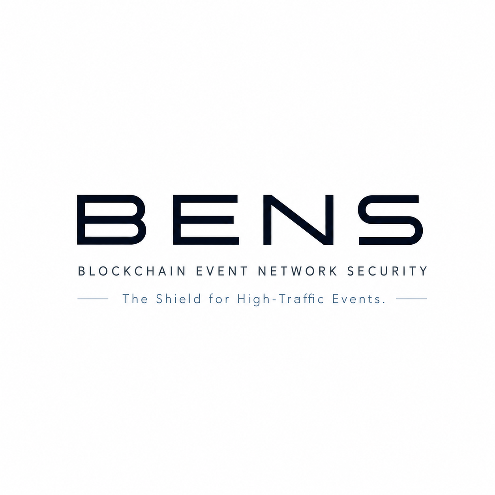

# BENS : Blockchain Event Network System

**Le middleware qui rend au marché secondaire sa valeur aux organisateurs.**

## Présentation

Aujourd'hui, une part significative des billets des grands événements finit
sur le marché secondaire, revendus à plusieurs fois leur prix facial. Toute
cette valeur échappe à l'organisateur : elle part aux scalpers et aux
plateformes de revente (Viagogo, StubHub…). En Web2, c'est une limite
**structurelle** — une fois le billet vendu, l'organisateur perd tout levier
sur les reventes ultérieures.

**Bens** est un middleware qui s'intègre entre les billetteries
traditionnelles (Digitick, Ticketmaster, etc.) et la blockchain MultiversX.
Il permet à un organisateur, pour la première fois, de **capter une part de
chaque revente** en ancrant des royalties dans un smart contract immuable —
à perpétuité, automatiquement, sans intervention humaine.

> **Discipline middleware** : BENS est un *transmetteur de messages* et un
> *forgeur de NFT/SBT*. Il **n'est jamais une billetterie bis** : catalogue,
> plan de salle, panier, checkout et paiement € restent chez le partenaire
> Web2. BENS ne transporte que des identifiants opaques (`external_event_id`,
> `external_seat_id`) et des ordres de mint.

### Objectifs principaux

- **Captation de valeur (argument n°1)** : chaque revente génère
  automatiquement une royalty créditée à l'organisateur via le smart
  contract. L'organisateur transforme le marché secondaire, aujourd'hui
  valeur perdue, en **revenu récurrent**.
- **Gouvernance du marché secondaire** : plafond de prix de revente, SBT non
  transférable optionnel, limite par utilisateur, anti-bot — l'organisateur
  reprend le contrôle d'un marché qui lui échappait.
- **Anti-Crash (enableur technique, "le plus")** : verrouillage des sièges
  **en mémoire Redis** (scripts Lua atomiques) pour absorber les pics de
  vente sans solliciter la base SQL du partenaire. Indispensable pour que le
  système tienne la charge — mais ce n'est pas l'argument produit principal.

---

## Architecture et Services

### Bens Core (Java 25 LTS / Spring Boot 4.1)

Le centre de commande du middleware, qui pilote l'interaction avec le
partenaire et orchestre la certification.

- **API B2B partenaire** : surface contractée et volontairement minimale
  (`POST /seats/lock`, `POST /seats/unlock`, `GET /transactions/{id}`).
  Sécurisée par un `CustomAuthFilter` (clés API, IP whitelist, rate limiting).
- **Redis Layer** : gère les verrous atomiques par siège via un script Lua
  (`SET NX PX 600000`) pour garantir l'unicité des réservations en temps réel
  avec une latence sub-2 ms. **Aucune topographie de salle** n'est stockée :
  seule la clé opaque `lock:seat:{org_id}:{event_id}:{external_seat_id}` est
  posée.
- **Payment Webhook Receiver** : reçoit la confirmation de paiement € du
  partenaire (HMAC), écrit l'audit `TRANSACTION_AUDIT_LOGS` (`PENDING_MINT`,
  `tx_hash NULL`), répond `202`, puis **orchestre** le mint en appelant
  Bens Contracts.
- **ConfirmationConsumer** : consomme RabbitMQ à rythme contrôlé, passe
  l'audit à `MINTED`, envoie les **webhooks sortants HMAC** au partenaire.
- **Dashboard organisateur (Angular 21 LTS)** : configuration des bridges,
  déploiement du smart contract, suivi des transactions et **suivi des
  royalties perçues** sur le marché secondaire, RBAC
  (Merchant ↔ `ORGANIZATIONS`, Collaborator ↔ `USERS`).
- **QR Code statique** (scope POC SF-07) : billet certifié consultable côté
  acheteur final (statut `MINTED`).
- **Seul accès PostgreSQL** parmi les trois modules.

### Bens Contracts (Rust / MultiversX)

La logique métier immuable exécutée sur la blockchain, et la couche
d'abstraction Web3 (SDK MultiversX) — **cœur de la captation de valeur**.
**Pas d'accès PostgreSQL** : retourne adresse SC / `tx_hash` à Bens Core.

- **Déploiement des Smart Contracts** : crée et déploie le SC d'événement
  sur MultiversX ; Bens Core persiste l'adresse dans `EVENT_BRIDGES`.
- **Smart Governance (royalties + plafond)** : à chaque revente, le SC
  calcule et crédite automatiquement la royalty à l'organisateur, vérifie le
  plafond de prix, applique `max_tickets_per_user` et le mode SBT si
  activé. **C'est ici que la valeur du marché secondaire est captée** —
  sans action manuelle, à perpétuité.
- **Paymaster & Signer** : service de méta-transactions qui signe et paie
  les frais réseau sur MultiversX (Account Abstraction), offrant une
  expérience transparente — pas de fenêtre MetaMask, pas de manipulation de
  cryptomonnaies pour le fan.
- **Minting NFT/SBT** : génère les billets numériques en invoquant `mint()`
  sur MultiversX. Les métadonnées du token ne contiennent que l'identifiant
  opaque `external_seat_id` fourni par le partenaire — **jamais** `section`,
  `row` ou `seat_number` (discipline middleware).
- **Smart Wallet acheteur** : création de wallet via email/téléphone (xPortal),
  masquée derrière le Paymaster.

### Bens Bridge (Java 25 LTS / Spring Boot 4.1) & RabbitMQ

L'**oreille on-chain** : détecte la finalité, publie vers Core — pas de BDD,
pas de webhook partenaire.

- **Écouteur blockchain** : détecte les événements MultiversX confirmés
  (Mint, Transfer, Resale).
- **Publisher RabbitMQ** : publie les confirmations dans
  `bens.mint.confirmations` (exchange topic `bens.confirmations`,
  routing key `confirm.{org_id}.{event_id}`, DLQ persistante).
- **Pas d'accès PostgreSQL** ; **pas** d'envoi de webhook au partenaire
  (responsabilité de Bens Core).

> **Pas de RabbitMQ pour soumettre le mint** : l'ordre de mint est transmis
> de Bens Core à Bens Contracts (SDK). RabbitMQ porte les **confirmations
> on-chain** Bridge → Core. Core consomme à rythme contrôlé (~200 conf/s)
> puis notifie le partenaire (HMAC).

---

## Flux de Fonctionnement

### 1. Configuration (Setup)

L'organisateur initialise le *bridge* d'événement depuis le dashboard Bens.
Il saisit son `external_event_id` opaque (jamais le catalogue complet) et
configure les règles du smart contract
(`EVENT_SMART_RULES` : `token_type`, `max_resale_price_percent`,
`royalty_fee_percent`, `max_tickets_per_user`, `allow_secondary_market`).
Bens Core ordonne alors à Bens Contracts de **déployer le SC** sur MultiversX ;
Contract retourne l'adresse, Core la persiste, puis génère les clés API +
l'URL de webhook de callback. États du bridge :
`DRAFT → ACTIVE → PAUSED → ARCHIVED`.

> **Choix de captation** : l'organisateur décide ici du % de royalty qu'il
> captera sur chaque revente. Une fois le SC déployé, ce taux est immuable
> sur la chaîne — il ne peut pas être contourné.

### 2. Phase de Vente (Rush)

Le fan sélectionne sa place sur l'interface partenaire. Le partenaire appelle
`POST /seats/lock` avec son `external_seat_id` opaque. Bens Core pose un
verrou temporaire dans Redis via le script Lua atomique (`SET NX PX 600000`,
TTL 10 min). Si le verrou est obtenu → `200 OK` + TTL ; sinon → `409 Conflict`.
**0 écriture** en base SQL partenaire ou PostgreSQL pendant cette phase (NFR-03).

Le fan paie en euros sur le checkout du partenaire (Stripe/PayPlug). Le
partenaire envoie un **webhook paiement signé HMAC** à Bens Core, qui écrit
`TRANSACTION_AUDIT_LOGS` (`PENDING_MINT`, `tx_hash NULL`), répond `202`,
puis **ordonne à Bens Contracts de minter**. Bens Contracts soumet la
transaction via le Paymaster / SDK et renvoie un `tx_hash` (souvent encore
pending côté explorateur) ; Core le persiste **sans** passer à `MINTED`.

### 3. Réconciliation (Sync)

Bens Bridge détecte le Mint **confirmé** on-chain (source de vérité) et
publie dans RabbitMQ (`bens.mint.confirmations`). Bens Core consomme à
rythme contrôlé (~200 confirmations/s), met l'audit à `MINTED`, puis notifie
le partenaire via webhook HMAC — protégeant ainsi leur infrastructure SQL.

### 4. Revente sur le marché secondaire (valeur captée)

Lorsqu'un billet NFT est revendu, le smart contract Bens Contracts
**applique automatiquement** :

1. la vérification du plafond de prix (`max_resale_price_percent`) ;
2. le calcul de la royalty (`royalty_fee_percent` × prix de revente) ;
3. le crédit automatique de la royalty à l'organisateur ;
4. la vérification `max_tickets_per_user` (anti-bot) ;
5. si le billet est SBT, le blocage de la revente.

Bens Bridge détecte l'événement on-chain `Resale` et publie dans RabbitMQ ;
Bens Core persiste `SECONDARY_SALES` et le dashboard organisateur agrège.
**L'organisateur voit ses royalties s'accumuler en temps réel** — valeur
qui, sans BENS, serait partie aux scalpers.

---

## Sécurité et Résilience

- **Protection Anti-Doublon** : le Smart Contract sur MultiversX possède le
  registre final immuable. Même en cas d'incident sur le cache Redis, il est
  physiquement impossible de générer deux NFT pour le même siège. L'idempotence
  est garantie par un **UUID de transaction unique** propagé du webhook
  paiement jusqu'au mint et au webhook sortant
  (`TRANSACTION_AUDIT_LOGS.payment_provider_ref` est `UNIQUE`).
- **Tolérance aux pannes** : en cas d'indisponibilité du système partenaire,
  RabbitMQ conserve les messages de confirmation de manière persistante. La
  synchronisation reprend automatiquement dès le rétablissement du service.
  Un ReplayWorker rejoue les transactions bloquées via
  `transaction_audit_logs` (NFR-04).
- **Indisponibilité Web3 non bloquante** : l'achat en euros n'est **jamais**
  bloqué par une panne MultiversX — le mint est asynchrone (NFR-06).
- **Anti-bot** : `max_tickets_per_user` ancré dans le SC, `CustomAuthFilter`
  côté Bens Core (clés API, IP whitelist, rate limiting, `BLACKLISTED_IPS`).

---

## Pourquoi MultiversX ?

Le choix de l'infrastructure MultiversX est déterminant pour deux raisons :
**l'immuabilité des règles de captation de valeur** (le cœur du pitch) et la
**performance** (l'enableur Anti-Crash). Contrairement aux blockchains
traditionnelles, MultiversX offre des spécificités techniques qui servent
directement les objectifs de Bens.

### Immuabilité et captation de valeur (argument n°1)

Les royalties et le plafond de revente sont ancrés dans un smart contract
MultiversX **immuable**. Une fois déployé, aucun intermédiaire — ni plateforme
de revente, ni scalper, ni même l'organisateur — ne peut contourner ces
règles. C'est précisément ce qui rend la captation de valeur possible :
là où un système Web2 peut être contourné (revente hors plateforme), le SC
exécute la royalty à chaque transfer de token, sans exception.

### Scalabilité et Performance (Adaptive State Sharding)

Lors d'une mise en vente majeure (type Stade de France), le flux de
transactions peut saturer n'importe quelle base de données SQL ou blockchain
classique.

- **Capacité** : grâce au sharding horizontal, MultiversX peut traiter plus
  de 100 000 transactions par seconde (TPS).
- **Élimination des goulots d'étranglement** : les transactions de Bens sont
  réparties sur plusieurs shards, garantissant que la montée en charge d'un
  événement n'impacte pas la fluidité du réseau global.

### Coûts et Transparence du Gaz

Pour un middleware de billetterie, les frais de transaction (Gas) doivent être
négligeables et prévisibles.

- **Frais minimes** : les coûts par transaction sur MultiversX sont dérisoires
  (quelques centimes), ce qui permet à Bens d'absorber ces frais via son
  service de Paymaster.
- **Transparence totale** : l'utilisateur final ne voit jamais de fenêtre
  "Metamask" lui demandant des frais de gaz complexes. Bens utilise
  l'abstraction de compte pour rendre l'expérience identique à un achat
  e-commerce classique.

### Standard ESDT (Native NFTs)

MultiversX s'appuie sur la norme ESDT (Elrond Standard Digital Token) pour
l'émission des billets.

- **Performance native** : contrairement aux NFT sur d'autres chaînes qui
  reposent sur des Smart Contracts lourds (ERC-721), les NFT sur MultiversX
  sont natifs au protocole. Cela réduit la charge de calcul et augmente la
  sécurité.
- **Métadonnées intégrées** : l'identifiant opaque `external_seat_id` est
  inscrit directement dans le token, facilitant la vérification ultra-rapide
  aux entrées des stades — sans exposer le plan de salle du partenaire.

### Expérience Utilisateur et Abstraction (Portal X)

L'adoption massive nécessite de cacher la complexité technique de la
blockchain.

- **Visualisation intuitive** : grâce à des outils comme Portal X,
  l'utilisateur lambda peut visualiser son billet NFT, ses avantages exclusifs
  ou l'historique de sa place de manière ergonomique, sans avoir besoin de
  connaissances techniques en Web3.
- **Accessibilité** : le couplage entre Bens et l'écosystème MultiversX permet
  de créer des wallets via un simple email ou numéro de téléphone (xPortal),
  garantissant que le "vrai fan" n'est jamais freiné par la technologie.

---

## Stack Technique

| Couche | Technologie |
| :--- | :--- |
| Backend | **Java 25** (LTS), **Spring Boot 4.1** (Virtual Threads / Project Loom) |
| Frontend dashboard | **Angular 21** (LTS) |
| Blockchain | **MultiversX** (Smart Contracts en **Rust**) |
| Cache & Concurrency | **Redis** (scripts Lua atomiques) |
| Message Broker | **RabbitMQ** (exchange topic + DLQ) |
| Base relationnelle | **PostgreSQL 17** (audit, config bridges, webhooks) |
| Intégration | SDK MultiversX Java, Webhooks JSON API, HMAC |

> Stack **normative** pour le dépôt. Toute divergence doit être justifiée et
> mise à jour dans [`cahier-des-charges.md`](./cahier-des-charges.md) §1.2.

---

## Ressources liées

- Cahier des charges : [`cahier-des-charges.md`](./cahier-des-charges.md)
- Expression de besoin : [`expression-besoin.md`](./expression-besoin.md)
- MLD : [`../03-conception/mcd/mld.md`](../03-conception/mcd/mld.md)
- Planning : [`../02-gestion-projet/planning.md`](../02-gestion-projet/planning.md)
