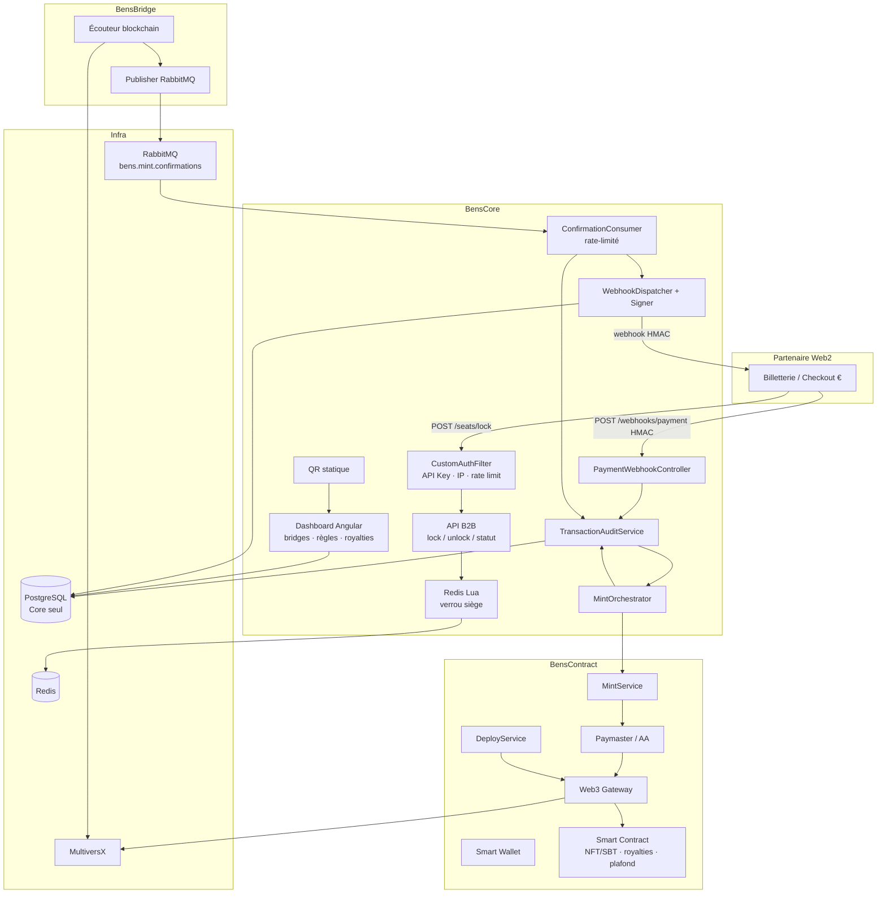
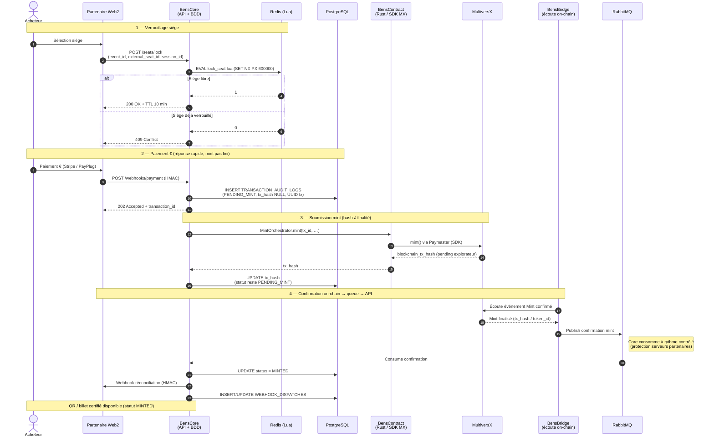
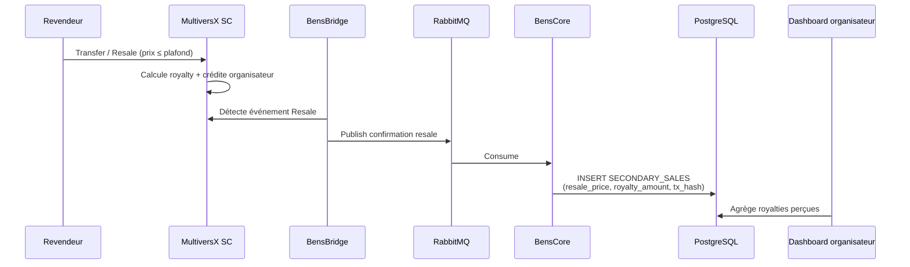
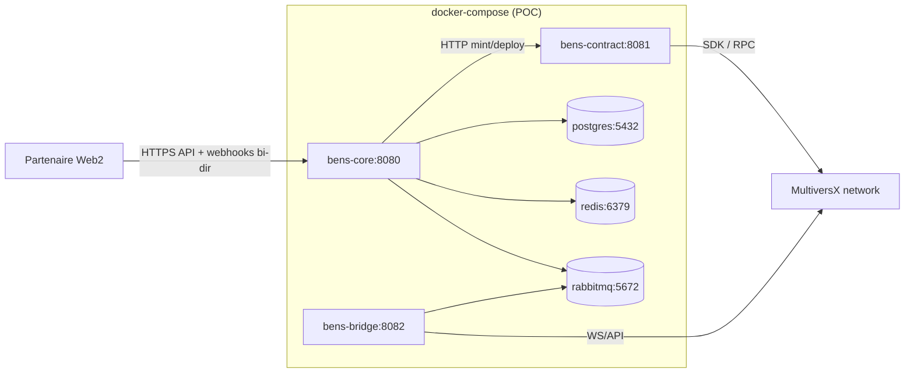

# Architecture technique — Projet BENS

> **Référence US 1.7** — Document d'architecture distribuée  
> **Source de vérité métier** : [`../01-contexte/cahier-des-charges.md`](../01-contexte/cahier-des-charges.md)  
> **Principe** : middleware transmetteur de messages + forgeur de NFT/SBT —
> **jamais une billetterie bis**.

---

## 1. Objectif d'architecture

BENS s'intercale entre une billetterie Web2 partenaire et MultiversX pour :

1. **Capter la valeur du marché secondaire** (royalties ancrées dans le SC —
   argument produit n°1).
2. **Certifier** chaque billet vendu (NFT/SBT) sans exposer le Web3 au fan.
3. **Absorber les pics de charge** (verrous Redis Lua) sans saturer le SQL
   partenaire — enableur technique.

L'architecture est **API-First**, **stateless**, **event-driven**, découpée
en **3 modules**. **Seul BensCore** lit/écrit PostgreSQL ; BensContract et
BensBridge n'ont pas d'accès BDD.

---

## 2. Vue d'ensemble — 3 modules

```text
┌──────────────────────┐      HTTP       ┌──────────────────────┐
│      BensCore        │ ──────────────────► │    BensContract      │
│  Java 25 / SB 4      │   (mint / deploy)   │  Rust + SDK MX      │
│                      │                     │                      │
│  • API lock/unlock   │                     │  • Déploiement SC    │
│  • Redis Lua         │                     │  • Mint NFT/SBT      │
│  • Webhook paiement  │                     │  • Paymaster (AA)    │
│  • Audit (seul BDD)  │                     │  • Smart Wallet      │
│  • MintOrchestrator  │                     │  • Web3 Gateway      │
│  • Consume RabbitMQ  │                     └──────────▲───────────┘
│  • Webhooks sortants │                                │ écriture
│  • Dashboard + QR    │                                │ on-chain
└──────────▲───────────┘                                │
           │ webhooks sortants HMAC                     │
           │                                            │ events
    ┌──────┴──────┐                          ┌──────────┴───────────┐
    │ Partenaire  │                          │     BensBridge       │
    │ Web2        │                          │  Java 25 / SB 4      │
    │ (VEL…)      │                          │                      │
    └─────────────┘                          │  • Écouteur chain    │
           ▲                                 │  • Publish RabbitMQ  │
           │                                 │  • Pas de BDD        │
           │                                 │  • Pas de webhook    │
           │                                 └──────────┬───────────┘
           │                                            │ confirmations
           │                                            ▼
           │                                       RabbitMQ
           │                                            │
           └──────────── Core consomme ─────────────────┘
                      (rythme contrôlé)
```

| Module | Rôle | Ne fait **pas** |
| :--- | :--- | :--- |
| **BensCore** | API partenaire, verrous Redis, **seule** écriture PostgreSQL, réception paiement, orchestration mint, consommation RabbitMQ (rythme contrôlé), webhooks sortants HMAC, dashboard, QR | Mint on-chain, écoute blockchain |
| **BensContract** | Microservice Rust : SDK MultiversX, déployer SC, mint, Paymaster, Smart Wallet, gateway | PostgreSQL, verrous Redis, webhooks partenaire |
| **BensBridge** | Écoute on-chain (Mint / Transfer / Resale), publie les confirmations dans RabbitMQ | PostgreSQL, mint, webhooks partenaire |

### Décisions d'architecture actées

| Décision | Conséquence |
| :--- | :--- |
| Webhook paiement reçu par **BensCore** | `INSERT TRANSACTION_AUDIT_LOGS` (`PENDING_MINT`, `tx_hash = NULL`) puis `202` |
| Mint orchestré par **BensCore** → **BensContract** | Appel direct ; **pas de RabbitMQ pour soumettre le mint** |
| Retour `tx_hash` (souvent pending explorateur) | Core **UPDATE** le hash ; statut reste `PENDING_MINT` (**pas** `MINTED`) |
| Chaîne = source de vérité pour la finalité | **BensBridge** détecte le Mint confirmé → publish RabbitMQ |
| RabbitMQ = Bridge → Core | Queue de **confirmations** ; Core consomme à rythme contrôlé |
| `MINTED` + webhook partenaire | **BensCore** uniquement (après consume) |
| PostgreSQL | **BensCore seul** (`schema.sql` / init Spring) ; Contract et Bridge sans BDD |
| Pas de Flyway | `CREATE TABLE IF NOT EXISTS` + Spring Boot `spring.sql.init` |

---

## 3. Stack technique

| Couche | Technologie | Contrainte |
| :--- | :--- | :--- |
| Backend Core / Bridge | Java **25**, Spring Boot **4+**, Virtual Threads | LTS / Loom |
| Backend Contracts | **Rust** (off-chain) + SDK / SC MultiversX | Workspace Cargo |
| Dashboard | Angular **18+** | RBAC organisateur |
| Cache / verrous | **Redis** + scripts Lua | TTL 10 min |
| Broker | **RabbitMQ** (topic + DLQ) | Confirmations Bridge → Core |
| BDD | **PostgreSQL** (UUID PK) | Accès **BensCore uniquement** |
| Intégration | Webhooks JSON + HMAC, SDK MultiversX | DX partenaire |

---

## 4. Diagramme de composants



### Responsabilités par composant (détail)

#### BensCore

| Composant | Responsabilité |
| :--- | :--- |
| `CustomAuthFilter` | Clé API, IP whitelist, rate limiting, isolation multi-tenant |
| API lock/unlock | Verrou Redis Lua atomique (`SET NX PX 600000`) |
| `PaymentWebhookController` | Réception HMAC paiement € → `202 Accepted` |
| `TransactionAuditService` | `INSERT PENDING_MINT` (`tx_hash NULL`) ; `UPDATE` hash après soumission ; `UPDATE MINTED` après confirmation |
| `MintOrchestrator` | Appelle BensContract, propage UUID transaction (idempotence) |
| `ConfirmationConsumer` | Consomme RabbitMQ à rythme contrôlé (protection serveurs partenaires) |
| `WebhookDispatcher` + Signer | Livraison HMAC sortante + `WEBHOOK_DISPATCHES` |
| Dashboard | CRUD `EVENT_BRIDGES` / `EVENT_SMART_RULES`, suivi `SECONDARY_SALES` |
| QR | Billet certifié (statique — scope POC SF-07) quand `MINTED` |

#### BensContract

| Composant | Responsabilité |
| :--- | :--- |
| DeployService | Déploie le SC via SDK ; **retourne** l'adresse à BensCore (Core écrit en BDD) |
| MintService | Invoque `mint()` on-chain, retourne `tx_hash` à BensCore |
| Paymaster | Paie les gas fees (Account Abstraction) |
| Smart Wallet | Wallet acheteur créé sans action manuelle |
| Web3 Gateway | Point unique MultiversX (API + SDK) |
| Smart Contract | Royalties, plafond, SBT, `max_tickets_per_user` |

#### BensBridge

| Composant | Responsabilité |
| :--- | :--- |
| Écouteur blockchain | Capte Mint / Transfer / Resale confirmés on-chain |
| Publisher RabbitMQ | Publie les confirmations vers `bens.mint.confirmations` |
| — | **Pas** d'accès PostgreSQL, **pas** de webhook partenaire |

---

## 5. Diagramme de séquence — parcours acheteur (paiement → mint → réconciliation)

> Aligné sur les décisions actées : Core seul sur la BDD et les webhooks ;
> Bridge = oreille on-chain ; Contract = bras SDK ; `MINTED` seulement après
> confirmation consommée.



### Mapping des 10 étapes

| # | Étape | Composant | Écriture |
| ---: | :--- | :--- | :--- |
| 1 | Sélection du siège | Partenaire Web2 | — |
| 2 | `POST /seats/lock` | BensCore → Redis Lua | — (in-memory) |
| 3 | Verrou 200 OK + TTL 10 min | BensCore | — |
| 4 | Paiement € | Partenaire Web2 | — |
| 5 | Webhook paiement | **BensCore** | `TRANSACTION_AUDIT_LOGS` (`PENDING_MINT`, `tx_hash NULL`) |
| 6 | Écriture audit + `202` | **BensCore** | idem |
| 7 | Ordre de mint | **BensCore → BensContract** | — (appel direct) |
| 8 | Soumission mint + hash | BensContract → MX → Core | Core `UPDATE` `tx_hash` (reste `PENDING_MINT`) |
| 9 | Confirmation on-chain + webhook | Bridge → MQ → **BensCore** | Core `UPDATE MINTED` + `WEBHOOK_DISPATCHES` |
| 10 | Billet + QR | BensCore | — |

### Parcours organisateur (configuration du bridge)

```text
1. Connexion Dashboard BENS (RBAC)
2. Création d'un EVENT_BRIDGES (status = DRAFT)
3. Saisie de external_event_id (opaque)
4. Configuration EVENT_SMART_RULES (1:1) :
   • token_type = NFT | SBT
   • max_resale_price_percent (BigDecimal)
   • royalty_fee_percent (BigDecimal)
   • max_tickets_per_user
   • allow_secondary_market
5. « Déployer & Activer »
6. BensCore orchestre → BensContract déploie le SC sur MultiversX
7. BensContract retourne smart_contract_address → BensCore l'écrit dans EVENT_BRIDGES
8. status → ACTIVE ; clés API + URL webhook déjà disponibles
   États : DRAFT → ACTIVE → PAUSED → ARCHIVED
```

### Captation de valeur (revente)



---

## 6. Persistance et flux de données

### 6.1. PostgreSQL (BensCore uniquement)

| Table | Écrit par | Lu par | Rôle |
| :--- | :--- | :--- | :--- |
| `MERCHANTS` | BensCore | BensCore | Partenaires B2B |
| `COLLABORATORS` | BensCore | BensCore | RBAC dashboard |
| `BLACKLISTED_IPS` | BensCore | BensCore | Ban IP |
| `EVENT_BRIDGES` | **BensCore** (adresse SC retournée par Contract) | BensCore | Bridge événement |
| `EVENT_SMART_RULES` | BensCore | BensCore / (lues via API vers Contract) | Royalties, plafond, SBT |
| `TRANSACTION_AUDIT_LOGS` | **BensCore** | BensCore | Audit mint |
| `SECONDARY_SALES` | **BensCore** (après msg Bridge) | BensCore (dashboard) | Preuve captation de valeur |
| `WEBHOOK_DISPATCHES` | **BensCore** | BensCore | Retries webhooks sortants |

Détail MLD : [`mcd/mld.md`](./mcd/mld.md) · DDL : [`mcd/schema.sql`](./mcd/schema.sql)

> **Aucune** table `events`, `seats`, `categories`, `prices`, `orders`.  
> **Aucun** email de contrepartie dans `SECONDARY_SALES`.

### 6.2. Redis (verrous uniquement)

| Clé | TTL | Rôle |
| :--- | :--- | :--- |
| `lock:seat:{org_id}:{event_id}:{external_seat_id}` | 10 min | Verrou atomique |
| `lock:session:{org_id}:{session_id}` | 10 min | Index cleanup session |

- `org_id` / `event_id` = **UUID BENS** (jamais de slug partenaire).
- `external_seat_id` = VARCHAR opaque, non interprété.
- **0 écriture** PostgreSQL pendant le lock (NFR-03).

### 6.3. RabbitMQ (confirmations Bridge → Core)

| Élément | Valeur |
| :--- | :--- |
| Exchange | `bens.confirmations` (topic) |
| Queue | `bens.mint.confirmations` |
| DLQ | `bens.mint.confirmations.dlq` |
| Routing | `confirm.{org_id}.{event_id}` |
| Producteur | **BensBridge** |
| Consommateur | **BensCore** (rate-limité) |
| Retry | 1s, 5s, 30s, 5min → DLQ après 4 tentatives |

> **Pas de queue pour soumettre le mint.** L'ordre de mint est un appel BensCore → BensContract.  
> RabbitMQ porte les **confirmations on-chain** (et reventes) vers Core.

---

## 7. Surface d'API partenaire (DX)

Surface volontairement contractée :

| Endpoint | Module | Rôle |
| :--- | :--- | :--- |
| `POST /seats/lock` | BensCore | Verrouiller → `200` + TTL ou `409` |
| `POST /seats/unlock` | BensCore | Libérer (compare-and-delete) |
| `POST /webhooks/payment` | **BensCore** | Paiement confirmé (HMAC) → `202` |
| `GET /transactions/{id}` | BensCore | Statut d'audit |
| Dashboard | BensCore (Angular) | Bridges, règles, royalties |

Codes d'erreur : `SEAT_ALREADY_LOCKED`, `SEAT_SOLD`, `MAX_TICKETS_REACHED`,
`INVALID_SIGNATURE`, `INVALID_API_KEY`, `IP_NOT_ALLOWED`, `RATE_LIMIT_EXCEEDED`.

Contrats détaillés : [`specifications.md`](./specifications.md) (US 1.7).

---

## 8. Diagramme de déploiement (cible POC — Sprint 6)



| Service | Image / runtime | Ports | Dépendances |
| :--- | :--- | :--- | :--- |
| `bens-core` | JVM Spring Boot 4 | 8080 | PostgreSQL, Redis, RabbitMQ, BensContract |
| `bens-contract` | Rust binary | 8081 | MultiversX (pas de PostgreSQL) |
| `bens-bridge` | JVM Spring Boot 4 | 8082 | RabbitMQ, MultiversX (pas de PostgreSQL) |
| `postgres` | PostgreSQL 16 | 5432 | Volume `pgdata` |
| `redis` | Redis 7 | 6379 | — |
| `rabbitmq` | RabbitMQ 3 + management | 5672 / 15672 | — |

> Dockerisation livrée en **US 5.7** (Sprint 6). En développement local, chaque
> module tourne hors conteneur avec les mêmes dépendances.

---

## 9. Sécurité transverse

| Couche | Mécanisme |
| :--- | :--- |
| API B2B | `X-BENS-Api-Key` hashée, IP whitelist, rate limiting |
| Webhooks entrants / sortants | Signature HMAC (**BensCore**) |
| Dashboard | JWT + RBAC (`ADMIN`, `CLIENT_SUCCESS`, `READ_ONLY`) |
| Secrets | Jamais en clair en BDD / logs (clés API, secrets webhook, clés chain) |
| Idempotence | UUID transaction + `UNIQUE(payment_provider_ref)` + `UNIQUE(blockchain_tx_hash)` sur reventes |
| Isolation multi-tenant | `organization_id` / `merchant_id` déduit de la clé API |

---

## 10. Qualité non fonctionnelle (rappel)

| ID | Cible | Composant |
| :--- | :--- | :--- |
| NFR-01 | Verrou < 2 ms | BensCore / Redis |
| NFR-02 | ≥ 10 000 req/s | BensCore |
| NFR-03 | 0 écriture SQL pendant le lock | BensCore |
| NFR-04 | Replay / tolérance aux pannes | BensCore (+ filet Bridge) |
| NFR-05 | Idempotence UUID | BensCore |
| NFR-06 | Indisponibilité Web3 non bloquante pour l'achat € | BensCore (`202` avant finalité mint) |

---

## 11. Traçabilité US 1.7

| Critère d'acceptation | Couverture |
| :--- | :--- |
| 3 modules + responsabilités | § 2 |
| PostgreSQL Core seul, Redis, RabbitMQ confirmations | §§ 2, 6 |
| Appel BensCore → BensContract pour le mint | §§ 2, 5 |
| Diagramme de composants | § 4 |
| Diagramme de séquence paiement → mint → webhook | § 5 |
| Diagramme de déploiement | § 8 |
| Alignement décisions actées | § 2 (tableau) |

---

## 12. Ressources liées

- Vision : [`../01-contexte/vision.md`](../01-contexte/vision.md)
- Expression de besoin : [`../01-contexte/expression-besoin.md`](../01-contexte/expression-besoin.md)
- Cahier des charges : [`../01-contexte/cahier-des-charges.md`](../01-contexte/cahier-des-charges.md)
- Spécifications : [`specifications.md`](./specifications.md)
- MCD / MLD : [`mcd/mcd.md`](./mcd/mcd.md) · [`mcd/mld.md`](./mcd/mld.md)
- Planning : [`../02-gestion-projet/planning.md`](../02-gestion-projet/planning.md)
- Ticket : [US 1.7 #39](https://github.com/2025-10-CDA-ECO-P6/bens/issues/39)
