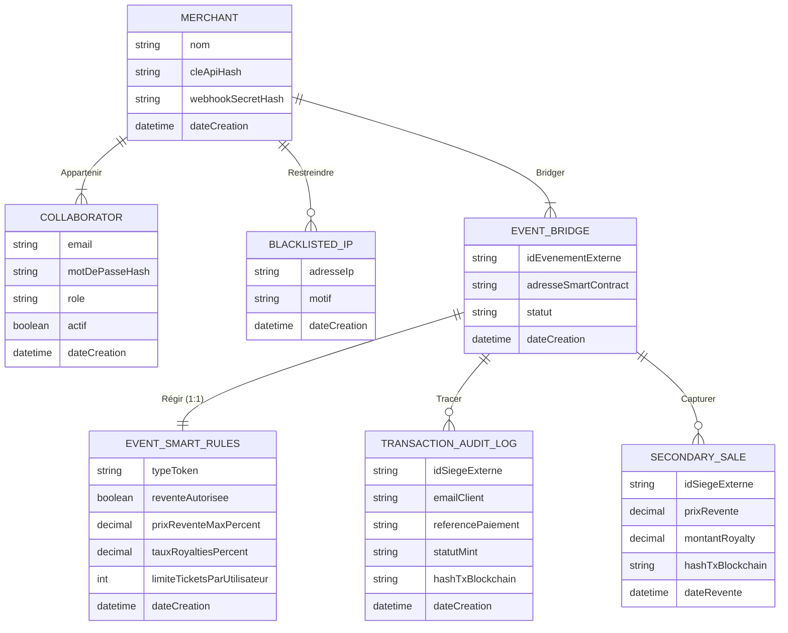

# Modèle Conceptuel de Données (MCD) — BENS Middleware

> **Référence US 1.2** — Modélisation conceptuelle et logique (mode Stateless)
> **Discipline** : structure relationnelle pour l'*auditabilité* et la
> *configuration* — **sans dupliquer** la base billetterie du partenaire Web2.
> **Argument n°1** : la **captation de valeur** sur le marché secondaire
> (royalties ancrées dans le SC, tracées dans `SecondarySale`).

---

## 1. Principes de modélisation

| Principe | Application |
| :--- | :--- |
| Stateless | Aucun état de panier / siège / stock en BDD SQL ; les verrous vivent en Redis |
| Identifiants opaques | `external_event_id`, `external_seat_id` = VARCHAR, jamais FK vers un modèle partenaire |
| Middleware only | Pas d'entités `Event`, `Seat`, `Order`, `Price`, `Category` |
| Multi-tenant | Toute donnée métier middleware est ratchée à un `Merchant` |
| Captation de valeur | Les reventes sont tracées (`SecondarySale`) **sans** stocker les comptes des contreparties (discipline middleware) |

---

## 2. Entités conceptuelles (critères US 1.2)

### 2.1. Merchant

Partenaire B2B (billetterie Web2 / organisateur) qui intègre le middleware BENS.

| Propriété | Type conceptuel | Description |
| :--- | :--- | :--- |
| nom | Chaîne | Raison sociale / nom commercial |
| cleApiHash | Chaîne | Empreinte de la clé d'API (jamais en clair) |
| webhookSecretHash | Chaîne | Secret HMAC pour signer/vérifier les webhooks |
| dateCreation | DateHeure | Création du compte marchand |

### 2.2. Collaborator

Utilisateur du Dashboard BENS rattaché à un Merchant (RBAC).

| Propriété | Type conceptuel | Description |
| :--- | :--- | :--- |
| email | Chaîne | Identifiant de connexion |
| motDePasseHash | Chaîne | Mot de passe haché (BCrypt/Argon2) |
| role | Chaîne | `ADMIN` \| `CLIENT_SUCCESS` \| `READ_ONLY` |
| actif | Booléen | Compte actif / suspendu |
| dateCreation | DateHeure | Création du collaborateur |

### 2.3. BlacklistedIp

Adresse IP interdite d'accès aux API / Dashboard pour un Merchant (sécurité B2B).

| Propriété | Type conceptuel | Description |
| :--- | :--- | :--- |
| adresseIp | Adresse | IPv4/IPv6 (ou CIDR) blacklistée |
| motif | Chaîne | Raison du ban (abus, scraping, etc.) |
| dateCreation | DateHeure | Horodatage du ban |

> Entité **propre à la sécurité middleware** — ne duplique aucune donnée billetterie partenaire.

### 2.4. EventBridge

Configuration du *bridge* d'un événement partenaire : liaison entre
l'événement Web2 (identifiant opaque) et le smart contract MultiversX déployé
par Bens Contracts. C'est ici que Bens Contracts **stocke l'adresse du SC**
déployé sur chaîne.

| Propriété | Type conceptuel | Description |
| :--- | :--- | :--- |
| idEvenementExterne | Chaîne | ID opaque de l'événement côté Web2 |
| adresseSmartContract | Chaîne | Adresse SC MultiversX (nullable tant que non déployé) |
| statut | Chaîne | `DRAFT` \| `ACTIVE` \| `PAUSED` \| `ARCHIVED` |
| dateCreation | DateHeure | Création du bridge |

### 2.5. EventSmartRules

Règles ancrées dans le smart contract d'un `EventBridge` (relation **1:1**) :
ce sont ces règles qui rendent la **captation de valeur** possible.

| Propriété | Type conceptuel | Description |
| :--- | :--- | :--- |
| typeToken | Chaîne | `NFT` \| `SBT` |
| reventeAutorisee | Booléen | Marché secondaire autorisé |
| prixReventeMaxPercent | Décimal | Plafond revente (% du facial) — `BigDecimal` |
| tauxRoyaltiesPercent | Décimal | Royalties organisateur (% de la revente) — `BigDecimal` |
| limiteTicketsParUtilisateur | Entier | Anti-bot (défaut 4) |
| dateCreation | DateHeure | Création des règles |

> Séparée d'`EventBridge` pour coller au planning (US 4.4 CRUD
> `EVENT_BRIDGES` / US 4.5 CRUD `EVENT_SMART_RULES`) et refléter la
> responsabilité de Bens Contracts (déploiement + stockage de l'adresse SC
> dans `EVENT_BRIDGES`).

### 2.6. TransactionAuditLog

Journal d'audit réactif : paiement € confirmé → mint Web3 (résilience,
idempotence).

| Propriété | Type conceptuel | Description |
| :--- | :--- | :--- |
| idSiegeExterne | Chaîne | ID opaque du siège côté partenaire |
| emailClient | Chaîne | Email acheteur final (transport uniquement, mint initial) |
| referencePaiement | Chaîne | Réf. Stripe/PayPlug (**unique** — dédoublonnage) |
| statutMint | Chaîne | `PENDING_MINT` \| `MINTED` \| `FAILED` \| `REFUNDED` |
| hashTxBlockchain | Chaîne | Hash MultiversX (nullable tant que non mint) |
| dateCreation | DateHeure | Réception du webhook paiement |

### 2.7. SecondarySale

**Preuve de captation de valeur** : chaque revente on-chain détectée par
Bens Bridge est tracée ici. Le dashboard organisateur agrège ces lignes pour
afficher les royalties perçues. **Aucun email** de vendeur/acheteur n'est
stocké (discipline middleware — les contreparties restent anonymes côté BENS).

| Propriété | Type conceptuel | Description |
| :--- | :--- | :--- |
| idSiegeExterne | Chaîne | ID opaque du siège revendu |
| prixRevente | Décimal | Prix de revente on-chain (`BigDecimal`) |
| montantRoyalty | Décimal | Royalty captée par l'organisateur (`BigDecimal`) |
| hashTxBlockchain | Chaîne | Hash MultiversX de la revente (preuve on-chain) |
| dateRevente | DateHeure | Horodatage on-chain de la revente |

> Entité **centrale pour l'argument n°1** (captation de valeur). Sans elle, le
> dashboard organisateur ne peut pas afficher les royalties perçues.

---

## 3. Associations et cardinalités

| Association | Entité A | Card. A | Entité B | Card. B | Sens métier |
| :--- | :--- | :---: | :--- | :---: | :--- |
| **Appartenir** | Merchant | 1,N | Collaborator | 1,1 | Un marchand a N collaborateurs ; un collaborateur appartient à 1 marchand |
| **Restreindre** | Merchant | 0,N | BlacklistedIp | 1,1 | Un marchand peut blacklister 0..N IP ; une IP ban est liée à 1 marchand |
| **Bridger** | Merchant | 1,N | EventBridge | 1,1 | Un marchand administre N bridges ; un bridge appartient à 1 marchand |
| **Régir** | EventBridge | 1,1 | EventSmartRules | 1,1 | Un bridge a exactement 1 jeu de règles (1:1) |
| **Tracer** | EventBridge | 0,N | TransactionAuditLog | 1,1 | Un bridge trace 0..N mints ; une transaction référence 1 bridge |
| **Capturer** | EventBridge | 0,N | SecondarySale | 1,1 | Un bridge capture 0..N royalties de revente ; une revente référence 1 bridge |

---

## 4. Schéma MCD (Mermaid — source versionnée)

---

## 5. Hors périmètre MCD (volontaire)

Conformément à la discipline middleware, **absents du MCD** :

- Catalogue d'événements, catégories, descriptions
- Plan de sièges / labels (`section`, `rang`, `numéro`)
- Panier, checkout, prix, stock
- Compte acheteur final (seul `emailClient` est transporté dans l'audit du mint initial)
- **Comptes vendeur/acheteur des reventes** (`SecondarySale` ne stocke aucun email — discipline middleware)

Les verrous de sièges (`lock:seat:...`) sont **hors BDD** (Redis in-memory).

---

## 6. Exports graphiques

| Fichier | Description |
| :--- | :--- |
| `MCD.png` | Export graphique du MCD (Graphviz) |
| `mcd.dot` | Source Graphviz du schéma MCD |
| `mcd.md` | Présent document (source textuelle) |

---

## 7. Traçabilité US 1.2

| Critère | Couverture |
| :--- | :--- |
| MCD : Merchant, Collaborator, BlacklistedIp, EventBridge, EventSmartRules, TransactionAuditLog, SecondarySale | § 2 |
| Mode Stateless / pas de duplication partenaire | §§ 1 et 5 |
| Captation de valeur modélisée (royalties tracées) | §§ 2.5 et 2.7 |
| Export schémas + sources | § 6 + dérivation MLD dans `mld.md` |
